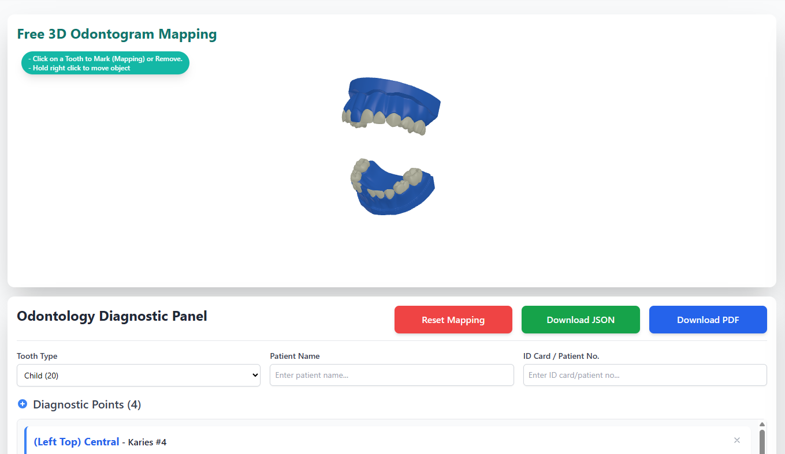

# Jivident 3D Odontogram 🦷

Jivident 3D Odontogram is a free modern, interactive web-based dental mapping (odontogram) application designed to digitize dental records into an intuitive 3D format.

This repo is a monorepo with two parts:

- **Demo app** (this root folder) — the Next.js application you see in the screenshot below.
- **[`packages/odontogram-3d`](packages/odontogram-3d)** — the reusable 3D canvas, published to npm as
  [`3d-odontogram`](https://www.npmjs.com/package/3d-odontogram). Install it in *any* React project to
  embed the same 3D odontogram with your own colors — see its [README](packages/odontogram-3d/README.md)
  for the full props/theme reference.

## Screenshots



## Key Features

- Interactive 3D visualization (rotate, zoom, pan)
- Click-to-mark dental conditions
- Supports FDI & Universal Numbering
- Responsive design
- Fully customizable colors (tooth, highlight, marker, canvas background, lights) via the
  [`3d-odontogram`](https://www.npmjs.com/package/3d-odontogram) package's `theme` prop
- Powered by Next.js, TypeScript, and Three.js

## Tech Stack

- Next.js (App Router)
- TypeScript
- Three.js (via the `3d-odontogram` package)
- Tailwind CSS

## Getting Started

### Running the demo app

```bash
git clone https://github.com/jivimuz/Jivident_3D_Odontogram.git
cd Jivident_3D_Odontogram
npm install
npm run dev
```

Open: `http://localhost:3000`

This installs the whole npm workspace (demo app + the `3d-odontogram` package it depends on). If you only
want to rebuild the package itself, run `npm run build:lib`.

### Using the 3D odontogram in your own project

```bash
npm install 3d-odontogram three react react-dom
```

```tsx
import { Odontogram3D } from "3d-odontogram";

<Odontogram3D
  toothType="adult"
  theme={{ toothColor: "#fdf6e3", highlightColor: "#e11d48", canvasBackground: "#0f172a" }}
/>
```

Watermark **Jivident** ditampilkan otomatis di kanan bawah canvas. Watermark
tidak menangkap klik atau drag, sehingga interaksi 3D tetap berjalan. Teksnya
dapat diganti atau disembunyikan:

```tsx
<Odontogram3D watermark="Jivident 3D" />
<Odontogram3D watermark={false} />
```

Full usage, props and theme defaults: [packages/odontogram-3d/README.md](packages/odontogram-3d/README.md).

## Usage Guide

**Navigation:**

- Left-click drag → Rotate
- Right-click drag / two fingers → Pan
- Scroll → Zoom
- Click a tooth → Add a diagnostic point
- Click the selected tooth again → Remove its diagnostic point

### Reading selected tooth data

The reusable component reports the current selection through
`onPointsChange`. The callback receives the complete, latest `MappedPoint[]`
array after every add, remove, reset, or import operation:

```tsx
"use client";

import { useRef, useState } from "react";
import {
  Odontogram3D,
  type MappedPoint,
  type Odontogram3DHandle,
} from "3d-odontogram";

export default function Chart() {
  const [points, setPoints] = useState<MappedPoint[]>([]);
  const odontogramRef = useRef<Odontogram3DHandle>(null);

  return (
    <>
      <div style={{ height: 600 }}>
        <Odontogram3D
          ref={odontogramRef}
          toothType="adult"
          onPointsChange={setPoints}
        />
      </div>
      <pre>{JSON.stringify(points, null, 2)}</pre>
    </>
  );
}
```

Each selected point contains `id`, `toothId`, `x`, `y`, `z`, `type`, and
`description`. To read it when the user presses Save, attach a ref and call:

```tsx
const points = odontogramRef.current?.getMappedPoints() ?? [];
const selectedToothIds = points.map((point) => point.toothId);
```

The package README contains the complete API reference, examples for editing
metadata, resetting, importing, exporting, theming, and self-hosting model
files: [packages/odontogram-3d/README.md](packages/odontogram-3d/README.md).

## License

MIT License

---

Made by Jivident - Jivi Muzaqi Guntur
