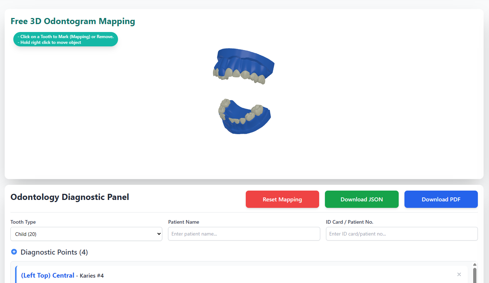

# 3d-odontogram (Bahasa Indonesia)

Komponen React + Three.js untuk menampilkan odontogram gigi 3D yang dapat
dirotasi, di-zoom, dan diberi titik diagnosis dengan klik. Package ini
menyimpan state pemetaan di dalam setiap instance komponen, sehingga beberapa
odontogram dapat digunakan pada halaman yang sama.



## Instalasi

```bash
npm install 3d-odontogram three react react-dom
```

`react`, `react-dom`, dan `three` adalah peer dependency, jadi harus dipasang
di aplikasi yang menggunakan package ini.

## Penggunaan dasar

```tsx
"use client";

import { Odontogram3D } from "3d-odontogram";

export default function Page() {
  return (
    <div style={{ width: "100%", height: 600 }}>
      <Odontogram3D toothType="adult" />
    </div>
  );
}
```

Canvas mengisi ukuran parent-nya. Karena itu parent harus memiliki `width` dan
`height`. Pada Next.js App Router, komponen yang menggunakan odontogram harus
berjalan sebagai Client Component.

### Kontrol 3D

- Drag tombol kiri mouse: rotasi model.
- Drag tombol kanan mouse: pan.
- Scroll: zoom.
- Klik gigi: tambah titik diagnosis.
- Klik gigi yang sudah dipilih: hapus pemetaan pada gigi tersebut.

Satu gigi hanya dapat memiliki satu titik aktif dari interaksi klik. Saat gigi
yang sama diklik kembali, seluruh titik untuk `toothId` tersebut dihapus.

## Mengambil data gigi yang diklik atau dipilih

Cara utama adalah `onPointsChange`. Callback ini dipanggil setiap kali titik
ditambah, dihapus, di-reset, atau diganti. Nilainya selalu berupa array
terbaru, sehingga cocok langsung disimpan ke React state atau dikirim ke API.

```tsx
"use client";

import { useState } from "react";
import { Odontogram3D, type MappedPoint } from "3d-odontogram";

export default function DentalChart() {
  const [selectedPoints, setSelectedPoints] = useState<MappedPoint[]>([]);

  function handlePointsChange(points: MappedPoint[]) {
    setSelectedPoints(points);

    // Data terbaru dari gigi yang dipilih:
    console.log("semua pilihan:", points);
    console.log("gigi yang dipilih:", points.map((point) => point.toothId));
  }

  return (
    <>
      <div style={{ width: "100%", height: 600 }}>
        <Odontogram3D
          toothType="adult"
          onPointsChange={handlePointsChange}
        />
      </div>

      <pre>{JSON.stringify(selectedPoints, null, 2)}</pre>
    </>
  );
}
```

Contoh hasil satu klik:

```json
[
  {
    "id": 1730812345678,
    "toothId": "Tooth-11",
    "x": "1.23",
    "y": "4.56",
    "z": "-2.10",
    "type": "Karies",
    "description": ""
  }
]
```

Nilai `x`, `y`, dan `z` adalah koordinat titik klik dalam world space Three.js
dan dikirim sebagai `string` dengan dua angka desimal. `toothId` mengikuti
pemetaan nama gigi pada model yang digunakan. `type` default dari klik adalah
`"Karies"`.

### Mengambil data secara manual dengan `ref`

Gunakan `Odontogram3DHandle` jika data perlu dibaca setelah aksi lain, misalnya
saat tombol Simpan ditekan:

```tsx
"use client";

import { useRef } from "react";
import {
  Odontogram3D,
  type MappedPoint,
  type Odontogram3DHandle,
} from "3d-odontogram";

export default function SaveButtonExample() {
  const odontogramRef = useRef<Odontogram3DHandle>(null);

  function handleSave() {
    const points: MappedPoint[] =
      odontogramRef.current?.getMappedPoints() ?? [];

    console.log("data untuk disimpan:", points);
    // fetch("/api/odontogram", {
    //   method: "POST",
    //   headers: { "Content-Type": "application/json" },
    //   body: JSON.stringify(points),
    // });
  }

  return (
    <>
      <div style={{ width: "100%", height: 600 }}>
        <Odontogram3D ref={odontogramRef} onPointsChange={console.log} />
      </div>
      <button type="button" onClick={handleSave}>
        Simpan pilihan
      </button>
    </>
  );
}
```

Untuk mengambil data gigi tertentu:

```tsx
const allPoints = odontogramRef.current?.getMappedPoints() ?? [];
const tooth11 = allPoints.find((point) => point.toothId === "Tooth-11");
const selectedToothIds = allPoints.map((point) => point.toothId);
```

`getMappedPoints()` mengembalikan salinan array, jadi aman untuk dibaca tanpa
mengubah state internal komponen.

## Mengubah metadata, reset, dan import data

### Mengubah `description` atau metadata lain

`updatePoint` mengubah metadata titik berdasarkan `id` tanpa menggambar ulang
model:

```tsx
odontogramRef.current?.updatePoint(1730812345678, {
  type: "Tambalan",
  description: "Lesi pada permukaan oklusal",
});
```

### Reset semua pilihan

```tsx
odontogramRef.current?.resetMapping();
```

### Memuat pilihan dari database atau JSON

Data yang sudah disimpan dapat dipasang kembali dengan `initialPoints` saat
komponen dibuat, atau dengan `setMappedPoints` setelah model selesai dimuat:

```tsx
<Odontogram3D
  toothType="adult"
  initialPoints={pointsFromDatabase}
/>
```

```tsx
odontogramRef.current?.setMappedPoints(pointsFromDatabase);
```

`pointsFromDatabase` harus mengikuti bentuk `MappedPoint[]`. Titik dengan
`toothId` yang tidak ada pada model akan diabaikan saat marker digambar, namun
tetap berada di array data yang diberikan.

## Props

| Prop | Tipe | Default | Keterangan |
| --- | --- | --- | --- |
| `toothType` | `"child" \| "adult"` | `"child"` | Model 20 gigi susu atau 32 gigi dewasa. |
| `theme` | `OdontogramTheme` | lihat di bawah | Warna gigi, highlight, marker, background, dan lampu. |
| `modelBaseUrl` | `string` | CDN jsDelivr | Folder tempat file model `.bin.gz` disajikan. |
| `modelFileNames` | `{ child?: string; adult?: string }` | `ip1.bin.gz` / `ip3.bin.gz` | Override nama file model. |
| `initialPoints` | `MappedPoint[]` | `undefined` | Titik yang digambar setelah model selesai dimuat. |
| `onPointsChange` | `(points: MappedPoint[]) => void` | `undefined` | Dipanggil saat pilihan berubah. |
| `onLoadingChange` | `(loading: boolean) => void` | `undefined` | Status pemuatan model. |
| `minDistance` / `maxDistance` | `number` | `100` / `130` | Batas zoom kamera. |
| `watermark` | `string \| false` | `"Jivident"` | Teks watermark di kanan bawah canvas. Gunakan `false` untuk menyembunyikannya. |
| `className` / `style` | `string` / `React.CSSProperties` | `undefined` | Diteruskan ke `<canvas>`. |

### `MappedPoint`

```ts
interface MappedPoint {
  id: number;
  toothId: string;
  x: string;
  y: string;
  z: string;
  type: string;
  description?: string;
}
```

### `Odontogram3DHandle`

```ts
interface Odontogram3DHandle {
  resetMapping: () => void;
  getMappedPoints: () => MappedPoint[];
  setMappedPoints: (points: MappedPoint[]) => void;
  updatePoint: (id: number, patch: Partial<MappedPoint>) => void;
  applyTheme: (theme: OdontogramTheme) => void;
}
```

## Tema warna

```tsx
<Odontogram3D
  theme={{
    toothColor: "#fdf6e3",
    highlightColor: "#e11d48",
    markerColor: "#111827",
    canvasBackground: "#0f172a",
    canvasBackgroundOpacity: 1,
    ambientLightColor: "#ffffff",
    ambientLightIntensity: 0.9,
  }}
/>
```

Warna dapat berupa angka hex Three.js (`0xff0000`) atau string CSS (`"#ff0000"`,
`"red"`). Default theme:

| Key | Default |
| --- | --- |
| `toothColor` | `0xf5f5dc` |
| `highlightColor` | `0x3b82f6` |
| `markerColor` | `0xff0000` |
| `canvasBackground` | `0xecf0f1` |
| `canvasBackgroundOpacity` | `0` |
| `ambientLightColor` / `ambientLightIntensity` | `0xffffff` / `0.8` |
| `keyLightColor` / `keyLightIntensity` | `0xffffff` / `0.6` |
| `fillLightColor` / `fillLightIntensity` | `0xffffff` / `0.4` |

## Hosting file model

File model `ip1.bin.gz` (child) dan `ip3.bin.gz` (adult) tidak dibundel ke
package karena ukurannya besar. Secara default keduanya diambil dari CDN
jsDelivr repository ini. Untuk offline atau self-hosting, salin file model ke
folder public aplikasi lalu atur URL-nya:

```tsx
<Odontogram3D
  toothType="child"
  modelBaseUrl="/odontogram-assets"
  modelFileNames={{
    child: "child-model.bin.gz",
    adult: "adult-model.bin.gz",
  }}
/>
```

## License

MIT
