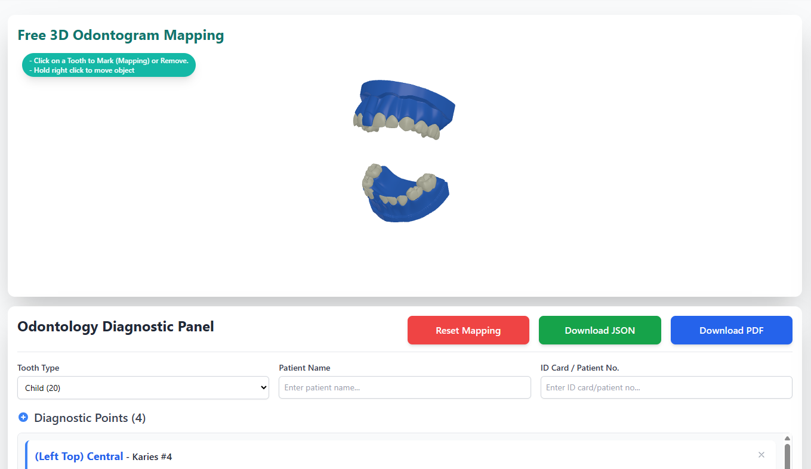

# 3d-odontogram

Customizable React + Three.js 3D odontogram. Rotate, zoom, and click teeth to
place diagnostic points. Each component instance owns its own scene and
mapping state.

**Documentation:** English (default) · [Bahasa Indonesia](README.id.md) ·
[简体中文](README.zh-CN.md) · [日本語](README.ja.md) · [한국어](README.ko.md) ·
[Español](README.es.md) · [Português do Brasil](README.pt-BR.md) ·
[Français](README.fr.md)



## Install

```bash
npm install 3d-odontogram three react react-dom
```

`react`, `react-dom`, and `three` are peer dependencies. In Next.js App
Router, use the component from a Client Component.

## Basic usage

```tsx
"use client";

import { Odontogram3D } from "3d-odontogram";

export default function Page() {
  return (
    <div style={{ width: "100%", height: 600 }}>
      <Odontogram3D toothType="adult" />
    </div>
  );
}
```

The parent element must have an explicit width and height because the canvas
fills its parent. Left drag rotates, right drag pans, and scroll zooms.
Click a tooth to add a diagnostic point; click it again to remove its points.

## Reading selected tooth data

`onPointsChange` receives the complete current `MappedPoint[]` after every
add, remove, reset, or replacement:

```tsx
"use client";

import { useState } from "react";
import { Odontogram3D, type MappedPoint } from "3d-odontogram";

export default function DentalChart() {
  const [points, setPoints] = useState<MappedPoint[]>([]);

  return (
    <>
      <div style={{ width: "100%", height: 600 }}>
        <Odontogram3D toothType="adult" onPointsChange={setPoints} />
      </div>
      <pre>{JSON.stringify(points, null, 2)}</pre>
    </>
  );
}
```

Example point:

```json
{
  "id": 1730812345678,
  "toothId": "Tooth-11",
  "x": "1.23",
  "y": "4.56",
  "z": "-2.10",
  "type": "Karies",
  "description": ""
}
```

Read the current data with a ref:

```tsx
import { useRef } from "react";
import { Odontogram3D, type Odontogram3DHandle } from "3d-odontogram";

const odontogramRef = useRef<Odontogram3DHandle>(null);
const points = odontogramRef.current?.getMappedPoints() ?? [];
const tooth11 = points.find((point) => point.toothId === "Tooth-11");

<Odontogram3D ref={odontogramRef} />;
```

## Mapping control

```tsx
odontogramRef.current?.updatePoint(123, {
  type: "Filling",
  description: "Occlusal lesion",
});
odontogramRef.current?.resetMapping();
odontogramRef.current?.setMappedPoints(pointsFromDatabase);
```

Use `initialPoints={pointsFromDatabase}` to restore points during the initial
model load. `pointsFromDatabase` must be a `MappedPoint[]`.

## Props

| Prop | Type | Default | Description |
| --- | --- | --- | --- |
| `toothType` | `"child" \| "adult"` | `"child"` | 20-tooth child or 32-tooth adult model. |
| `theme` | `OdontogramTheme` | defaults | Tooth, highlight, marker, background, and light colors. |
| `modelBaseUrl` | `string` | jsDelivr CDN | Base URL for `.bin.gz` model files. |
| `modelFileNames` | `{ child?: string; adult?: string }` | `ip1.bin.gz` / `ip3.bin.gz` | Override model names. |
| `initialPoints` | `MappedPoint[]` | `undefined` | Points rendered after loading. |
| `onPointsChange` | `(points: MappedPoint[]) => void` | `undefined` | Called whenever mapping changes. |
| `onLoadingChange` | `(loading: boolean) => void` | `undefined` | Model loading status. |
| `minDistance` / `maxDistance` | `number` | `100` / `130` | Camera zoom limits. |
| `watermark` | `string \| false` | `"Jivident"` | Bottom-right watermark; `false` hides it. |
| `className` / `style` | — | `undefined` | Applied to the canvas. |

### Data types

```ts
interface MappedPoint {
  id: number;
  toothId: string;
  x: string;
  y: string;
  z: string;
  type: string;
  description?: string;
}

interface Odontogram3DHandle {
  resetMapping: () => void;
  getMappedPoints: () => MappedPoint[];
  setMappedPoints: (points: MappedPoint[]) => void;
  updatePoint: (id: number, patch: Partial<MappedPoint>) => void;
  applyTheme: (theme: OdontogramTheme) => void;
}
```

## Theme and model hosting

```tsx
<Odontogram3D
  theme={{
    toothColor: "#fdf6e3",
    highlightColor: "#e11d48",
    markerColor: "#111827",
    canvasBackground: "#0f172a",
    canvasBackgroundOpacity: 1,
  }}
/>
```

Colors accept Three.js hex numbers or CSS strings. The default model URLs are:

```text
child → https://cdn.jsdelivr.net/gh/jivimuz/Jivident_3D_Odontogram@main/public/assets/bin/ip1.bin.gz
adult → https://cdn.jsdelivr.net/gh/jivimuz/Jivident_3D_Odontogram@main/public/assets/bin/ip3.bin.gz
```

Models load from jsDelivr automatically and are not bundled in npm. For
self-hosting, copy them to your public folder and use:

```tsx
<Odontogram3D toothType="adult" modelBaseUrl="/odontogram-assets" />
```

## License

MIT
